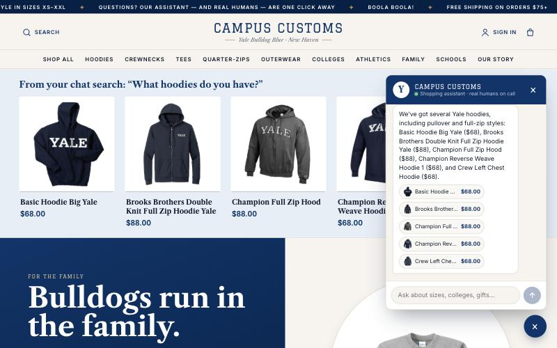

# AI Shopping Chatbot: Campus Customs storefront

A full e-commerce storefront for Campus Customs, a Yale apparel store concept with 102 products, plus a floating AI shopping assistant. The assistant answers product, price, and stock questions straight from the store's SQLite database, shows its answers as clickable product cards, and hands off to a human when it can't help.

- **Frontend:** Vite + React 19 + TypeScript
- **Backend:** FastAPI
- **Agent:** PydanticAI (`gpt-5.6-luna` via Portkey), with three read-only database tools and per-turn limits

**[See the project write-up in my portfolio →](https://ishanya-anthapur.vercel.app/#chatbot)**



## Layout

```
./
├── AI_prompts.md          # log of the prompts used to build the project
├── requirements.txt       # backend Python dependencies
├── .env.example           # copy to .env and add your PORTKEY_API_KEY
├── .gitignore
├── README.md
├── frontend/              # Vite React TypeScript app
├── backend/
│   ├── main.py            # FastAPI app — run with: uvicorn main:app --reload
│   ├── agent.py           # PydanticAI agent, model wiring, loop limits
│   ├── models.py          # Pydantic models for tools, chat and handoff
│   ├── tools.py           # search_products / get_product_details / get_stock_by_size
│   ├── prompts/
│   │   └── prompt.md      # agent instructions + safety rules
│   ├── db.py              # shared SQLite helpers
│   ├── audit.py           # append-only audit trail writer
│   └── scripts/           # product photo cleanup (optional)
├── data/                  # NOT in Git — add the local data pack here (see below)
└── output/
    ├── harness.md         # full technical write-up (models, tools, safety, limits, how to run)
    ├── design.md
    ├── usability.md
    ├── app_check.html
    ├── app_check_images/  # screenshots linked from app_check.html
    └── audit_trail.json
```

## Setup

You need Python 3.11+ (built and tested on 3.13), Node.js 20.19+ or 22.12+ (required by Vite 8; tested on 24), and a Portkey API key.

### 1. Add the data pack (not included in this repository)

The store database and product photos are excluded from Git. Copy them in so the folder looks
like this:

```
data/
├── campus_customs.db      # SQLite database: catalogue, inventory, users, chat_messages
└── products/              # original product photos, e.g. basic-hoodie-big-yale.jpg
```

The backend reads `data/campus_customs.db` and serves photos from `data/products/`. It
also needs write access to the database, because accounts, chat history and support inquiries
are saved there.

*Optional:* many original photos have black backgrounds. To generate the white-background copies
the redesigned site uses, run the cleanup script after installing the backend (step 3). It writes
`data/products_clean/`, which the backend uses automatically when it exists; the originals are
never modified.

```bash
cd backend
.venv/bin/python scripts/clean_product_images.py
```

### 2. Add your API key

```bash
cp .env.example .env
```

Then edit `.env` and set `PORTKEY_API_KEY`. `OPENAI_MODEL` is already set to
`gpt-5.6-luna`. Never commit `.env`; it's in `.gitignore`.

### 3. Backend (http://localhost:8000)

```bash
cd backend
python3 -m venv .venv
.venv/bin/pip install -r ../requirements.txt
.venv/bin/uvicorn main:app --reload --port 8000
```

### 4. Frontend (http://localhost:5173)

Run this in a second terminal:

```bash
cd frontend
npm install
npm run dev
```

Open http://localhost:5173. Keep the default ports: the frontend calls `localhost:8000`, and the
backend only accepts requests from `localhost:5173`.

**Demo login:** `test@campuscustoms.yale.edu` / `password` (an account in the data pack's database,
with a saved chat history).

## Where to look

- `output/harness.md`: how everything works, with an "Agent Reference" covering models, tools,
  safety rules, loop limits, the audit trail and run commands.
- `output/app_check.html`: three live checks with screenshots. Open the file directly in a
  browser.
- `output/usability.md`, `output/design.md`: the usability improvements and the visual redesign.
- `output/audit_trail.json`: one entry per chatbot turn.
- `AI_prompts.md`: the prompts used to build the project.
